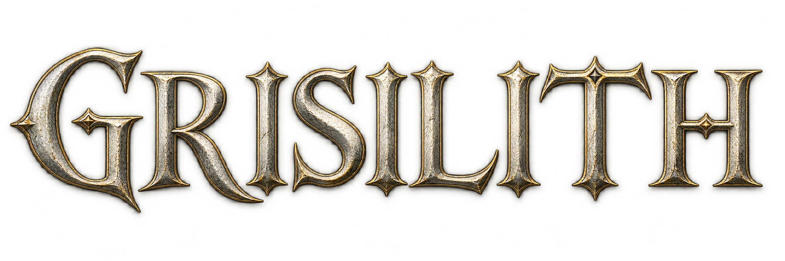
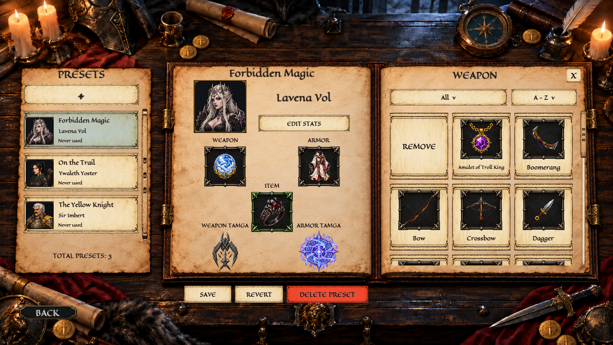
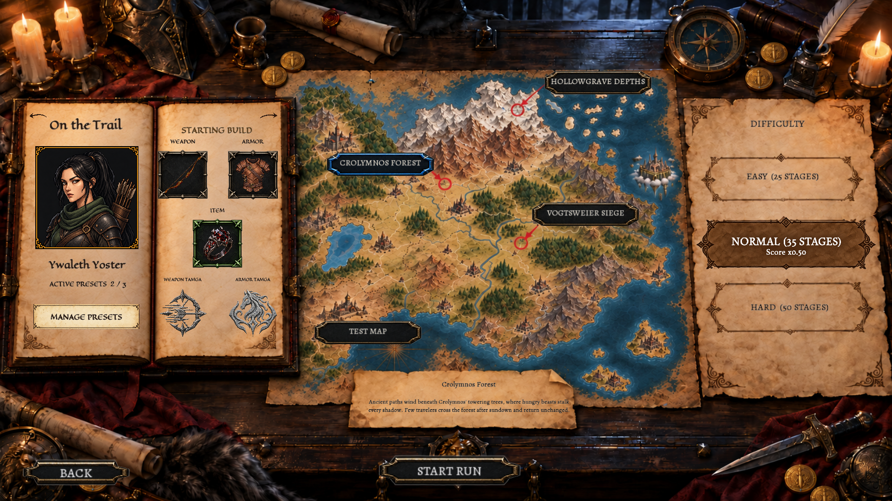
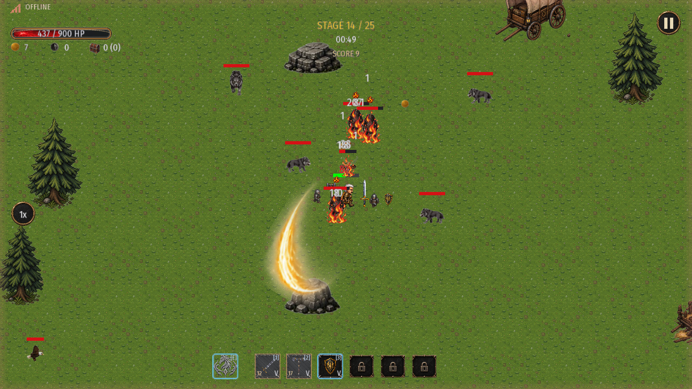
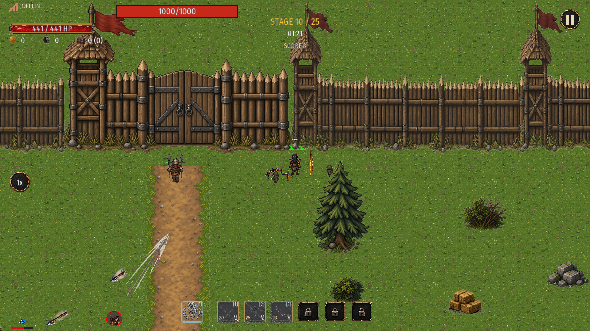
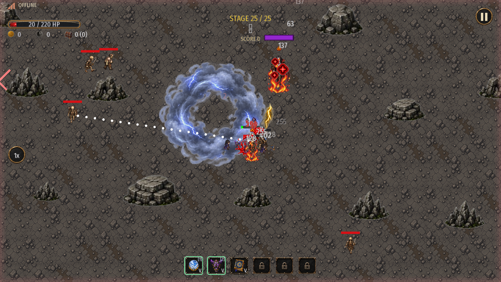

> This page is available in English and Turkish. Scroll down for the Turkish section.  
> Bu sayfa İngilizce ve Türkçedir. Türkçe bölüm için aşağıya ilerleyebilirsiniz.

  

  <strong>Dark Fantasy · Survival · Build Crafting</strong> 
  Windows · v0.3.9 Open Beta

## Welcome to Grisilith

Choose your character, prepare your gears, and face increasingly dangerous waves of enemies. Grisilith is a dark fantasy survival action-roguelite game where your equipment, upgrades, and decisions shape each run.

Combine weapons, armor, items, and Tamgas to discover different ways to survive—from close-range combat and projectile-heavy builds to elemental spells and summoned allies.

**You can download the game [here](https://github.com/AtaberkAzizoglu/Grisilith-Game/releases/download/v0.3.9/Grisilith.Beta.zip).**

## What awaits you?

- **Five playable characters:** Sir Imbert, Lavena Vol, Ywaleth Yoster, Koba, and Linlos Dustman, each with their own traits, strengths and weaknesses.
- **Build preparation:** Create and save presets, allocate your stats, and choose your starting equipment.
- **Weapons that evolve:** Upgrade and merge melee, ranged, and spell-focus weapons to unlock new attack patterns, abilities, and spells.
- **More ways to customize:** Combine armor, items, and Tamgas to support your strategy or try something unexpected.
- **Three distinct battlegrounds:** Face the beasts of Crolymnos Forest, endure Vogtsweier Siege, and descend into Hollowgrave Depths.
- **Boss encounters:** Adapt to enemies with different abilities, defenses, resistances, and weaknesses.
- **Online leaderboards:** Compete for a place among the highest-scoring runs and give Praise to other players’ achievements. Offline play is also available, but offline runs do not enter the leaderboard.

## Gameplay / Oynanış

**Prepare your build / Build’inizi hazırlayın**

**Choose your battleground / Savaş alanınızı seçin**

**Crolymnos Forest — Melee combat / Yakın dövüş**

**Vogtsweier Siege — Defend the walls / Surları savunun**

**Hollowgrave Depths — Magic and a boss encounter / Büyüler ve boss karşılaşması**

## Open Beta

Grisilith is actively in development. This beta is an opportunity to explore the game and help shape what comes next.

New players start with **1,000 Grisilith Coins** to help try the Merchant’s offerings.

You may encounter bugs, unfinished elements, or balance issues. Features and progression may change in future versions. The tutorial is planned for **v0.4**.

## Feedback & Contact

Found a bug, discovered an unusual interaction, or have something to say about the game? Your feedback is welcome.

For bug reports, please include the game version, what happened, and how to reproduce it. Screenshots or short recordings are especially helpful.

- **Email:** [aa.ataberk.98@gmail.com](mailto:aa.ataberk.98@gmail.com)
- **X / Twitter:** [@o1cylon](https://x.com/o1cylon)
- **Discord:** o1cylon

Developed by **o1cylon**.

## Roadmap

### Coming Next

- **A new map arc:** Three new maps, each with unique gameplay mechanics, new enemies, and new adventures.
- **Tileset improvements.**
- **A tutorial** to help new players find their footing.

### Longer-Term Plans

- New characters, weapons, Tamgas, and items.
- Visual improvements for characters and effects.
- Audio improvements for enemies and characters.
- **AND MUCH MORE!**

---

# Türkçe

  <strong>Karanlık Fantezi · Hayatta Kalma · Build Oluşturma</strong> 
  Windows · v0.3.9 Açık Beta

## Grisilith’e Hoş Geldiniz

Karakterinizi seçin, ekipmanlarınızı hazırlayın ve giderek tehlikeli hâle gelen düşman dalgalarıyla yüzleşin. Grisilith; ekipmanlarınızın, geliştirmelerinizin ve kararlarınızın her koşuyu şekillendirdiği, karanlık fantezi temalı bir hayatta kalma ve aksiyon-roguelite oyunudur.

Silahları, zırhları, item’ları ve tamga’ları bir araya getirerek farklı oyun tarzlarını keşfedin. Yakın dövüşten menzilli saldırılara, element büyülerinden yanınızda savaşan summon’lara kadar birçok farklı yaklaşımı deneyin.

**Oyunu buradan [indirebilirsiniz](https://github.com/AtaberkAzizoglu/Grisilith-Game/releases/download/v0.3.9/Grisilith.Beta.zip).**

## Sizi Neler Bekliyor?

- **Beş oynanabilir karakter:** Kendilerine özgü trait’leri, güçlü ve zayıf yönleriyle Sir Imbert, Lavena Vol, Ywaleth Yoster, Koba ve Linlos Dustman.
- **Build hazırlama:** Preset’lerinizi oluşturup kaydedin, stat puanlarınızı dağıtın ve başlangıç ekipmanlarınızı seçin.
- **Gelişen silahlar:** Melee, ranged ve spell-focus silahları geliştirip birleştirerek yeni saldırı paternleri, ability’ler ve spell’ler açın.
- **Farklı kombinasyonlar:** Zırhları, item’ları ve tamga’ları stratejinize göre birleştirin veya alışılmışın dışında bir şey deneyin.
- **Üç farklı savaş alanı:** Crolymnos Forest’ın vahşi hayvanlarıyla yüzleşin, Vogtsweier Siege’de kuşatmaya dayanın ve Hollowgrave Depths’in derinliklerine inin.
- **Boss karşılaşmaları:** Farklı yetenekleri, savunmaları, dirençleri ve zayıflıkları olan düşmanlara karşı taktiklerinizi uyarlayın.
- **Çevrimiçi sıralama:** En yüksek skorlu koşular arasına girmeye çalışın ve diğer oyuncuların başarılarına Praise verin. İnternetsiz de oynayabilirsiniz; ancak offline koşular sıralamaya katılmaz.

## Açık Beta

Grisilith’in geliştirilmesi devam ediyor. Bu beta, oyunu keşfetmeniz ve sonraki adımların şekillenmesine katkıda bulunmanız için bir fırsat.

Yeni oyuncular, Merchant’ın sunduklarını deneyebilmeleri için **1.000 Grisilith Coin** ile başlar.

Hatalarla, henüz tamamlanmamış içeriklerle veya denge sorunlarıyla karşılaşabilirsiniz. Gelecek sürümlerde özellikler ve ilerleme sistemi değişebilir. Tutorial’ın **v0.4** sürümünde eklenmesi planlanıyor.

## Geri Bildirim ve İletişim

Bir hata mı buldunuz, beklenmedik bir etkileşim mi keşfettiniz veya oyun hakkında paylaşmak istediğiniz bir düşünceniz mi var? Geri bildirimlerinizi bekliyorum.

Hata bildirirken oyun sürümünü, ne olduğunu ve sorunun nasıl tekrar oluşturulabileceğini belirtmeniz çok yardımcı olur. Ekran görüntüsü veya kısa video da ekleyebilirsiniz.

- **E-posta:** [aa.ataberk.98@gmail.com](mailto:aa.ataberk.98@gmail.com)
- **X / Twitter:** [@o1cylon](https://x.com/o1cylon)
- **Discord:** o1cylon

**o1cylon** tarafından geliştiriliyor.

## Yol Haritası

### Yakın Gelecekte

- **Yeni bir map arc’ı:** Her birinde özel oynanış mekanikleri, yeni düşmanlar ve yeni maceralar bulunan üç yeni harita.
- **Tileset düzenlemeleri.**
- Yeni oyuncuların oyuna alışmasını kolaylaştıracak bir **tutorial**.

### Uzun Vadede

- Yeni karakterler, silahlar, tamga’lar ve item’lar.
- Karakter ve efekt görsellerinde iyileştirmeler.
- Düşman ve karakter seslerinde iyileştirmeler.
- **VE ÇOK DAHA FAZLASI!**
